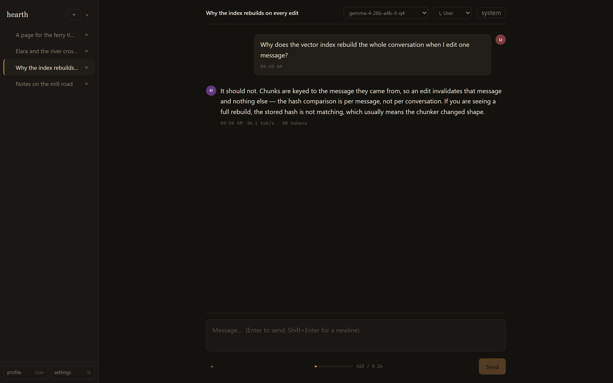
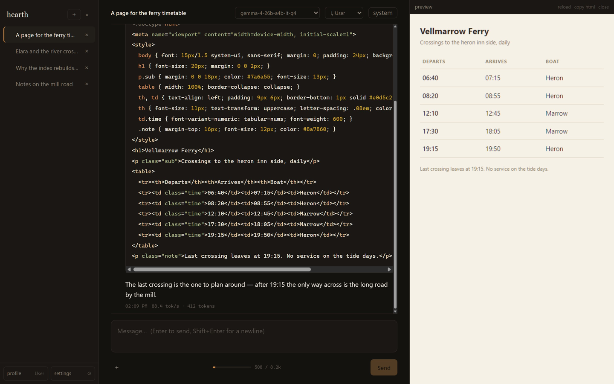
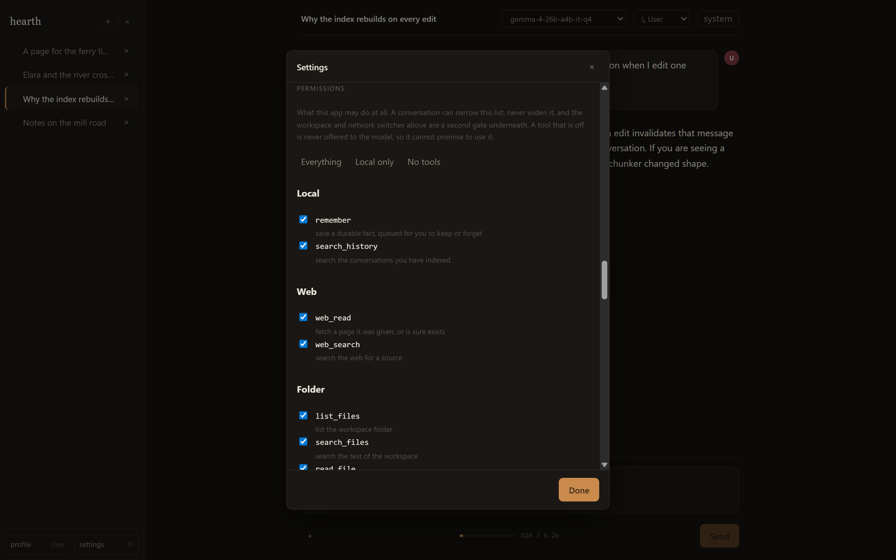
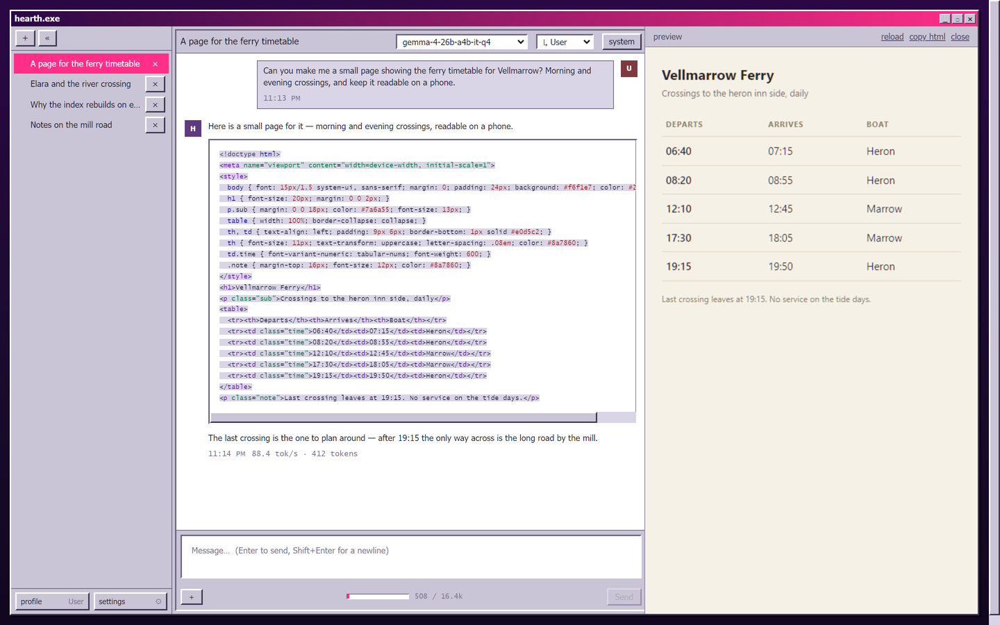

# Hearth

A local-first chat app over llama.cpp. Your machine, your models, your history — no account, no telemetry, nothing leaves the box.



## What it is

A desktop-shaped chat window that talks to a local `llama-server` over the OpenAI-compatible API, with a small Node manager beside it that owns the process, the files and the downloads. It does one thing: conversations with a model on your own GPU. No provider zoo, no settings labyrinth, no account.

The point isn't to beat Chatbox. It's to be small enough that every line is yours, and to learn the parts that are genuinely interesting: SSE streaming, abort handling, local persistence, markdown rendering under load, retrieval over your own history, and a sandboxed preview panel.

## Why this exists

**What it is:** a chat app to call your own — a programmatic expression of will.

**Why:** to spread and democratise AI, and make it easily accessible to all.

**Also:** a showcase. When someone asks what I've built, the answer is my own chat app — not a wrapper around someone else's.

### What that means in practice

A mission that doesn't constrain decisions is decoration. These are the constraints it puts on this project:

- **Accessible means no gatekeeping.** No account, no subscription, no telemetry, no cloud dependency. It runs on your machine, against your models, and works with the network unplugged.
- **"Your own" means it bends.** Themes, profiles, per-conversation prompts, your own backend. A starting point, not a fixed product.
- **A showcase means the code has to be readable.** Small files, one job each, comments that explain *why* rather than *what*. The git history is part of the deliverable — someone should be able to follow the reasoning, not just the result.
- **It stays a personal tool.** Serving thousands of users is a different product with a different trust model. That's a fork, not a feature — see [backlog.md](backlog.md).

## What's in it

**Talking to a model.** Streaming replies with live tokens per second and token counts, stop mid-reply, regenerate, edit-and-resend, reasoning blocks, markdown with copy buttons, per-conversation system prompts, profiles and characters, and a `Ctrl+K` palette that searches your messages.

**Memory that belongs to someone.** Facts are scoped to a character or to one conversation, never app-wide, so a roleplay cannot leak into a coding chat. The model proposes a fact and you keep or forget it; a background pass reads the transcript and captures what the model missed. The injected block says what it is, which is what stops the model re-saving its own facts in different words.

**Retrieval over your own history.** Opt-in per conversation. Messages are chunked, embedded by a second `llama-server`, and searched with a cross-encoder reranker over the top candidates; the reply cites the conversations it used and a chip jumps to the message. Vectors are a cache in IndexedDB — a wipe costs a re-index, not a conversation.

**A preview panel.** A reply containing a fenced `html` block renders beside the chat in a sandboxed frame (`allow-scripts`, never `allow-same-origin`, plus a CSP with `connect-src 'none'`). Two independent layers, and a 41-check attack suite proves each holds when the other is broken.



**Speech.** Replies read aloud by Qwen3-TTS on the same llama.cpp build, cloned per request from a clip you keep in `data/voices`. Nothing leaves the machine.

**Tools, and a page that says what they may do.** `remember`, `now`, `search_history`, `web_read`, `web_search`, and a read-only workspace folder (`list_files`, `search_files`, `read_file`). Every tool has a switch; a conversation can narrow the list and never widen it; the manager's workspace and network settings are a third gate underneath. A tool that is off is never offered to the model, so it cannot promise to use it.



**Five themes, including one that is not trying to be modern.** Themes are files: drop a `.json` into `data/themes/` and it appears in Settings.



**A library that survives the browser.** Conversations, messages, characters, profiles, prompts and memories live in `data/hearth.db` (SQLite, via `node:sqlite`), read through the manager. Clearing site data costs you the vector cache and nothing else. Export and import are whole-library or one chat.

**Downloads that are checked.** The manager fetches llama.cpp for your GPU, a chat model, a reranker and SearXNG. Every one is verified against a pinned SHA-256 before it is used, and an unverified file is refused rather than warned about.

## Run it

**Windows 10/11, Node 24 or newer, and git.** Node 24 is not a preference: the library is stored with `node:sqlite`, which is stable from 24. A GPU with enough VRAM for your model is strongly recommended; CPU works, slowly — measured 8.5 tok/s for the default model on a 6-core VM with no GPU.

```bash
git clone https://github.com/0xmp3/hearth.git
cd hearth
npm install
npm start
```

No git installed? Install it first (`winget install Git.Git`), or download the repository as a ZIP and extract it — `npm install && npm start` work the same either way.

Then open **http://localhost:5173**.

`npm start` brings up the manager (port 8090) and the app (port 5173) together, and Ctrl+C stops both — the manager stops `llama-server` through its own handle first, so nothing is orphaned. It runs the **vite dev server**, not a production build; there is no static server in the manager yet.

**First run, with nothing installed:**

1. **Settings → Backend → Engine** — detects your OS and GPU and offers a matching llama.cpp build. Nothing downloads until you press the button.
2. **Settings → Backend → Chat model** — one click, 4.6 GB, Gemma 4 E4B (Q4_0) from the llama.cpp project's own conversions, checked against the digest Hugging Face publishes for the file.
3. **Start server**, then talk to it.

**Already have a `llama-server`?** Point Settings → Backend → Endpoint at it and skip both downloads. The app uses whatever is listening; the manager is optional for chatting and required for reading your history.

**Themes are files.** Drop a `.json` theme into `data/themes/` and it appears in Settings; *Export this theme* gives you a valid starting point.

**System metrics** are off by default. Settings → System metrics adds a strip to the sidebar: VRAM, live tokens per second, and the machine behind them. Sampling only runs while the strip is visible.

## Status

**Alpha, 0.1.0.** Windows-only, single-user, no support. The `v1.x` tags in this repository are internal build history from before publication; the public line starts here.

**Verified on two machines.** The development machine — Windows 11, RX 9070 XT (16 GB), 64 GB RAM, Node 24 — where: the app builds and runs, a real model answers through the manager, the library survives a full site-data clear, retrieval returns the right message with a reranker, the preview panel renders and its attack suite passes 41/41, the workspace guard passes 21/21, and the engine, model and reranker downloads verify their digests. `npm test` runs 82 unit tests over the pure modules in under a second, and CI runs the same gate on every push.

And a **clean Windows 11 Pro VM** (Ryzen 5, 6 cores, 8 GB RAM, no GPU) that started with no git, no Node and no models: `winget` for git and Node, the tree extracted from a ZIP, `npm install`, `npm start`, the engine downloaded and its digest verified, the 4.6 GB model downloaded and **its digest checked against the pin**, the server started, and a real reply came back at 8.5 tok/s on CPU.

**Unproven, and worth saying plainly:**

- **Two machines is not a survey.** Both were virtual or owned by the author; no physical hardware, no integrated-GPU laptop, no Windows 10, and no machine where the download runs over a slow connection.
- **The two browser suites need a VM and a live manager**, so they are a manual acceptance test, not part of CI.
- **No installer, no code signing, no auto-update.** It is a repository you clone and run.
- **Only AMD/ROCm and CPU have been exercised.** The engine catalog covers NVIDIA, Intel, macOS and Linux, and the digest path is the same for all of them, but those builds have not been run here.

**Residual risks.** This app is not hardened, and the audit does not claim it is. What it does claim is that the risks are known and written down (`docs/security-audit.md`):

- **The SearXNG tarball is not signed.** A git commit tarball has no signature to verify, so integrity is HTTPS plus a pinned commit. Accepted.
- **The engine digest comes from the same release as the binary.** It proves the file arrived intact, not who made it. Trust anchors on the GitHub account that published the release.
- **DNS rebinding is open in the egress guard.** The hostname is checked, then the fetch happens; a name that answers public then private slips between the two. Proportionate for a local app whose egress you switched on, and documented in the module.
- **CSP cannot govern WebRTC.** A preview page could open an `RTCPeerConnection` to a STUN server the model named and leak the local IP. No app data is in that frame.
- **A preview page can still issue one navigation.** No CSP directive blocks a page navigating itself, so the panel detects it and replaces the frame with a notice instead. A navigation answered with no content never commits a document, so that case is silent and is recorded rather than papered over.
- **Loopback apps are reachable by any local page that guesses the port.** The `X-Hearth` header plus an exact-origin allow-list is the defence.

## Licence

**MIT** — see [LICENSE](LICENSE). Use it, fork it, build on it, keep the copyright line, no warranty.

## Running documents

| File | What's in it |
|---|---|
| [PLAN.md](PLAN.md) | Scope, decisions, phases, exit criteria, and the traps already hit |
| [backlog.md](backlog.md) | Every idea that is not in the current phase |
| [docs/readiness.md](docs/readiness.md) | What stood between the tree and being publishable, and what closed it |
| [docs/security-audit.md](docs/security-audit.md) | The audit: findings, evidence, fixes, residual risks |
| [docs/backend.md](docs/backend.md) | The exact HTTP contract, with verified sample responses |
| [docs/rag.md](docs/rag.md) | Retrieval: design, the test corpus, and the measurements |
